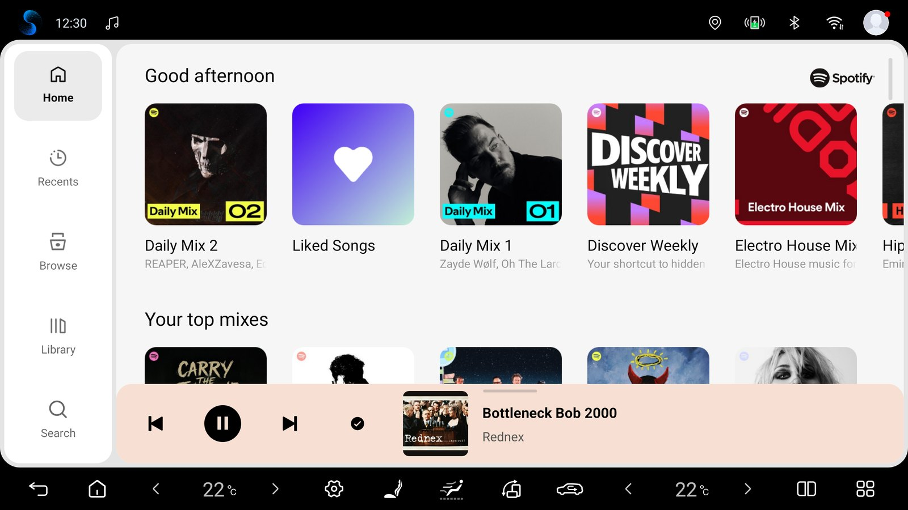

# Spotify для Android-магнитол

[English](README.md) · [Українська](README.uk.md) · [Русский](README.ru.md) · [العربية](README.ar.md) · [简体中文](README.zh-Hans.md)

Экспериментальный плеер Spotify Automotive для Android-магнитол. Интерфейс на основе BYD и музыкальный сервис объединены в одном APK с одним значком и стандартным входом Spotify.

[Скачать APK test.10](https://github.com/romanchukg-cloud/spotify-android-head-units/releases/download/v5.5.0-headunit-test.10/Spotify-5.5.0-HeadUnit-test.10.apk) · [🌐 Spotify для Android-магнитол](https://romanchukg-cloud.github.io/spotify-android-head-units/ru/)



## Что уже проверено

Headunit-test.10 добавляет Новый стиль, включённый по умолчанию: скруглённые карточки, шрифт Figtree, дневную и ночную темы, цвет обложки, перекомпонованный плеер с рабочей кнопкой «нравится», обложку и эквалайзер в очереди, скруглённые углы приложения и новые Настройки магнитолы. Классический стиль сохраняет прежний интерфейс. Закрытие Spotify теперь всегда останавливает музыку, а переключение дня и ночи с открытой Библиотекой больше не роняет плеер. Поскольку изменились ресурсы интерфейса, сборка сделана полной эталонной сборкой. Release-аудит: 45 PASS / 0 FAIL, пройдены 152 проверки обновлений и 39 проверок входа, сертификат подписи совпадает с test.9. В машине владельца (BYD DiLink 5.0 / Android 12) test.10 установлен обновлением поверх test.9: вход и музыка сохранились, Новый стиль проверен в дневной теме без сбоев. На эмуляторе Android 12 с реальным аккаунтом вход сохранился после обновления с test.9; проверены день и ночь, 1024×600 и портретная ориентация, переключение Классический ↔ Новый.

**Экспериментальная headunit-test.10.** Первое обновление с test.9 до test.10 через само приложение на магнитоле ещё не наблюдали. Новый стиль не проверяли на арабском (справа налево) и с раскладкой для правого руля, где плеер остаётся классическим. Также не проверены реальный сон/перезагрузка машины, аккаунты A → B → A, офлайн-загрузки, кнопки на руле, DiLink 5.1 / Android 13 и другие магнитолы.

Android 9+ (API 28). Ритм BYD проверен на DiLink 5 / Android 12; DiLink 5.1 / Android 13 и другие прошивки ещё не проверены. Профили AAOS и GENERIC реализованы; реальные магнитолы других производителей и AAOS ещё не проверены.

## Support and diagnostics

Open Head unit settings → Support. Send diagnostics lets you preview approved technical data before sending. Reports go to our shared server and a limited summary may appear in this project’s PUBLIC GitHub Issues. Automatically send diagnostics is selected on the first-use notice and starts only after Continue; you can turn it off in Support. Automatic reports cover measured integration failures only, at most one new report per day. Manual sending, pending status/cancellation and ZIP export remain available with automatic sending off. Reports exclude account data, song/playlist names, location and screenshots. Technical metadata is not a guarantee of anonymity.

## Как установить

1. Нажмите кнопку скачивания выше, чтобы получить APK, и перенесите его в мультимедийную систему.
2. Нашу предыдущую тестовую сборку с той же подписью обновляйте без удаления: авторизация может сохраниться. Сборки с другой подписью так не обновятся.
3. Откройте Spotify и при необходимости войдите по QR-коду.
4. Для подсветки BYD включите «Музыкальный ритм» в настройках салонной подсветки самого автомобиля. Этот переключатель в настройках машины, а не Spotify.
5. Чтобы добавить другого водителя: Настройки магнитолы → Аккаунты → Добавить аккаунт · QR. Переключение останавливает музыку и перезапускает плеер.
6. Проверьте музыку и управление. Удаляйте старый отдельный интерфейс BYD только после успешной проверки нового APK.

Android 9+ · 55,5 MiB · неофициальная адаптация

## Проверка файла

`Spotify-5.5.0-HeadUnit-test.10.apk` · 58 222 521 bytes

SHA-256 текущей тестовой сборки:

```text
ccf440e37acd3208f2b076d1023bfec9d5370c626230b65f12980b73f6fcf806
```

Неофициальный экспериментальный проект. Spotify и BYD — товарные знаки соответствующих владельцев.

## Исходный код и проверки

Наш Java-код интеграции, патчи, скрипты сборки, аудит и тесты эмуляторов доступны в репозитории. Закрытый SDK Spotify и интерфейс BYD — локальные входные файлы сборки.

[Java / build](adapter/) · [Что уже проверено](reports/headunit-test.10.md)
