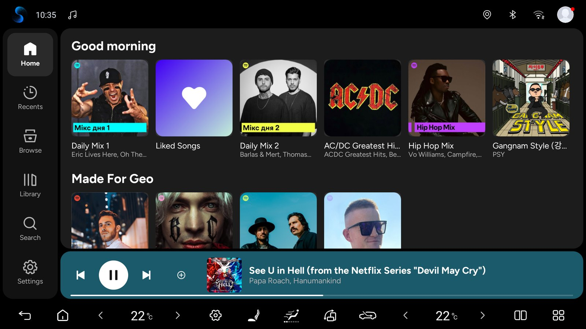

# Spotify для Android-магнітол

[English](README.md) · [Українська](README.uk.md) · [Русский](README.ru.md) · [العربية](README.ar.md) · [简体中文](README.zh-Hans.md)

Експериментальний плеєр Spotify Automotive для Android-магнітол із власним інтерфейсом, зробленим для авто: один APK, одна іконка й стандартний вхід у Spotify. Безкоштовно — ніколи не платіть за нього.

[Завантажити APK test.12](https://github.com/romanchukg-cloud/spotify-android-head-units/releases/download/v5.5.0-headunit-test.12/Spotify-5.5.0-HeadUnit-test.12.apk) · [🌐 Spotify для Android-магнітол](https://romanchukg-cloud.github.io/spotify-android-head-units/uk/)



## Що вже перевірено

Headunit-test.12 замінює інтерфейс на основі BYD власним: Головна, Бібліотека, Пошук, сторінки плейлістів, альбомів, виконавців і подкастів, повноекранний плеєр і черга на розмитій обкладинці, прогрес завантажень, таймер сну й повідомлення, що застосунок безкоштовний. Зібрано повною еталонною збіркою. Аудит релізу: 46 PASS / 0 FAIL, 152 перевірки оновлювача й 39 перевірок входу пройдено, сертифікат підпису збігається з test.11. На емуляторах Android 9 і 13 test.12 встановлюється як оновлення поверх test.11 і перевіряє оновлення без падінь. Проміжні збірки працювали в авто BYD (DiLink 5, Android 12): горизонтально, вертикально й у розділеному екрані з навігацією, вхід через QR, кнопки керма й Spotify Connect.

**Експериментальна headunit-test.12.** Сам файл релізу в авто ще не встановлювали. Праве кермо, DiLink 5.1 / Android 13 та інші магнітоли не перевірені; арабську перевірено лише на емуляторі. Spotify тримає завантаження вимкненими для свого клієнта Automotive; ця збірка вмикає наявну підтримку, тож Spotify може змінити їхню роботу.

Android 9+ (API 28). Ритм BYD перевірено на DiLink 5 / Android 12; DiLink 5.1 / Android 13 та інші прошивки ще не перевірені. Профілі AAOS і GENERIC реалізовано; реальні магнітоли інших виробників та AAOS ще не перевірені.

## Support and diagnostics

Open Head unit settings → Support. Send diagnostics lets you preview approved technical data before sending. Reports go to our shared server and a limited summary may appear in this project’s PUBLIC GitHub Issues. Automatically send diagnostics is selected on the first-use notice and starts only after Continue; you can turn it off in Support. Automatic reports cover measured integration failures only, at most one new report per day. Manual sending, pending status/cancellation and ZIP export remain available with automatic sending off. Reports exclude account data, song/playlist names, location and screenshots. Technical metadata is not a guarantee of anonymity.

## Як встановити

1. Натисніть кнопку завантаження вище, щоб отримати APK, і перенесіть його в мультимедійну систему.
2. Нашу попередню тестову збірку з тим самим підписом оновлюйте без видалення: авторизація може зберегтися. Збірки з іншим підписом так не оновляться.
3. Відкрийте Spotify й за потреби увійдіть через QR-код.
4. Для підсвітки BYD увімкніть «Музичний ритм» у налаштуваннях салонної підсвітки самого авто. Цей перемикач у налаштуваннях машини, а не Spotify.
5. Щоб додати іншого водія: Налаштування магнітоли → Акаунти → Додати акаунт · QR. Перемикання зупиняє музику й перезапускає плеєр.
6. Перевірте музику та керування. Старий окремий інтерфейс BYD видаляйте після успішної перевірки нового APK.

Android 9+ · 55,7 MiB · неофіційна адаптація

## Перевірка файлу

`Spotify-5.5.0-HeadUnit-test.12.apk` · 58 378 169 bytes

SHA-256 поточної тестової збірки:

```text
00f82a80d9a40d9d3138c3fde1d4c3c88edf270c380c54a70fa01032ab6982a1
```

Неофіційний експериментальний проєкт. Цей застосунок безкоштовний — якщо ви за нього заплатили, вимагайте гроші назад. Spotify та BYD — торговельні марки відповідних власників.

## Вихідний код і перевірки

Наш код Java — інтерфейс, інтеграція, скрипти латок і збирання, аудити та емуляторні тести — є в репозиторії. Пропрієтарний бекенд Spotify — локальний вхід збирання. APK ще містить частини плеєра BYD (Vivid): медіасервіс для голосового помічника авто, ресурси й шрифт; їх буде прибрано.

[Java / build](adapter/) · [Що вже перевірено](reports/headunit-test.12.md)
